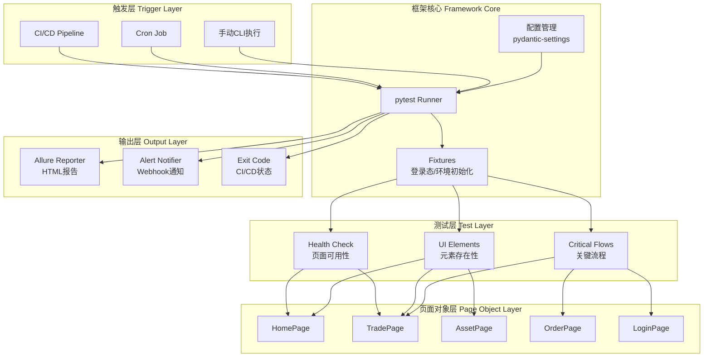
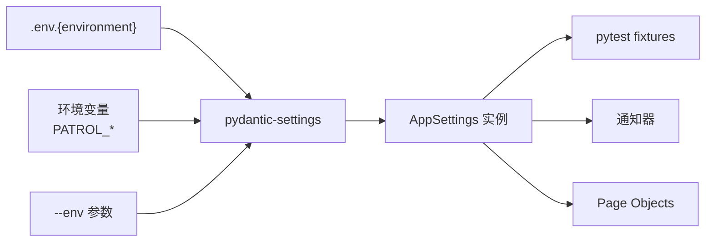
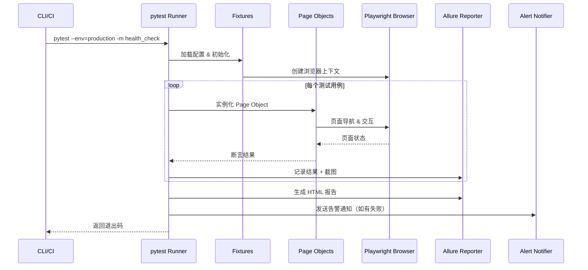

# 技术设计文档 - Exchange UI Patrol

## Overview

Exchange UI Patrol 是一套基于 Python + Playwright + pytest 的轻量级交易所Web页面巡检测试框架。框架面向资深QA工程师，提供对交易所生产环境和测试环境的自动化可用性巡检能力，包括页面加载检测、关键UI元素验证、核心交易流程模拟，以及测试报告生成和告警通知。

### 设计目标

- **轻量级**：纯代码框架，无Web Dashboard、数据库等重型基础设施
- **可扩展**：基于 Page Object Model，新增页面巡检只需添加 Page Object 和测试用例
- **多环境**：通过配置文件和环境变量灵活切换生产/测试环境
- **可观测**：Allure 报告 + 企业微信/钉钉 Webhook 告警
- **CI/CD友好**：标准化命令入口，支持 GitHub Actions / GitLab CI 集成

### 技术栈

| 类别 | 技术选型 | 版本要求 | 选型理由 |
|------|----------|----------|----------|
| 语言 | Python | ≥3.10 | 类型提示完善，生态丰富 |
| 浏览器自动化 | Playwright for Python | ≥1.40 | 跨浏览器支持，自动等待，网络拦截 |
| 测试框架 | pytest | ≥7.0 | fixture机制强大，插件生态丰富 |
| Playwright集成 | pytest-playwright | ≥0.4 | 官方维护，提供 page/context/browser fixtures |
| 配置管理 | pydantic-settings | ≥2.0 | 类型安全，支持 .env 文件和环境变量 |
| HTTP客户端 | httpx | ≥0.25 | 异步支持，类型友好，用于 Webhook 通知 |
| 测试报告 | allure-pytest | ≥2.13 | 报告美观，支持截图/步骤/附件 |
| 代码质量 | ruff | ≥0.1 | 快速 linter + formatter |
| 类型检查 | mypy | ≥1.5 | 静态类型检查 |
| 依赖管理 | poetry 或 pip + requirements.txt | - | 根据团队偏好选择 |

## Architecture

### 系统架构图



### 模块职责划分

| 模块 | 职责 | 依赖 |
|------|------|------|
| config | 环境配置加载与验证 | pydantic-settings |
| pages | Page Object 定义 | playwright |
| tests | 测试用例 | pytest, pages, config |
| fixtures | 通用前置条件 | pytest, pages, config |
| notifiers | 告警通知发送 | httpx |
| reporters | 报告增强（可选） | allure-pytest |
| utils | 工具函数 | - |

## Components and Interfaces

### 项目目录结构

```
exchange-ui-patrol/
├── conftest.py                  # pytest 全局 fixtures
├── pytest.ini                   # pytest 配置
├── pyproject.toml               # 项目元数据 + 依赖
├── README.md                    # 使用文档
│
├── config/
│   ├── __init__.py
│   ├── settings.py              # pydantic-settings 配置模型
│   └── environments/
│       ├── .env.production      # 生产环境配置
│       ├── .env.staging         # 测试环境配置
│       └── .env.example         # 配置模板
│
├── pages/
│   ├── __init__.py
│   ├── base_page.py             # BasePage 基类
│   ├── home_page.py             # 首页 Page Object
│   ├── trade_page.py            # 交易页 Page Object
│   ├── asset_page.py            # 资产页 Page Object
│   ├── order_page.py            # 订单页 Page Object
│   └── login_page.py            # 登录页 Page Object
│
├── tests/
│   ├── __init__.py
│   ├── health_check/            # 页面可用性检测
│   │   ├── __init__.py
│   │   ├── test_page_load.py
│   │   └── test_console_errors.py
│   ├── ui_elements/             # UI元素存在性验证
│   │   ├── __init__.py
│   │   ├── test_home_elements.py
│   │   ├── test_trade_elements.py
│   │   └── test_asset_elements.py
│   └── critical_flows/          # 关键流程验证
│       ├── __init__.py
│       ├── test_login_flow.py
│       ├── test_spot_order.py
│       └── test_cancel_order.py
│
├── fixtures/
│   ├── __init__.py
│   ├── auth.py                  # 登录态 fixture
│   └── environment.py           # 环境初始化 fixture
│
├── notifiers/
│   ├── __init__.py
│   ├── base.py                  # 通知器基类
│   ├── wecom.py                 # 企业微信通知
│   └── dingtalk.py              # 钉钉通知
│
├── utils/
│   ├── __init__.py
│   ├── retry.py                 # 重试装饰器
│   └── timing.py               # 耗时记录
│
├── reports/                     # 报告输出目录（gitignore）
│   └── .gitkeep
│
└── ci/
    ├── github-actions.yml       # GitHub Actions 模板
    └── gitlab-ci.yml            # GitLab CI 模板
```

### 核心类设计

#### 1. 配置管理 - `config/settings.py`

```python
from pydantic_settings import BaseSettings
from pydantic import Field
from typing import Optional
from enum import Enum


class Environment(str, Enum):
    PRODUCTION = "production"
    STAGING = "staging"


class AppSettings(BaseSettings):
    """应用全局配置"""
    env: Environment = Field(default=Environment.STAGING, description="目标环境")
    base_url: str = Field(description="目标环境基础URL")
    timeout: int = Field(default=30000, description="全局超时时间(ms)")
    headless: bool = Field(default=True, description="是否无头模式")
    slow_mo: int = Field(default=0, description="操作延迟(ms)，调试用")
    
    # 测试账号
    test_username: Optional[str] = Field(default=None, description="测试账号")
    test_password: Optional[str] = Field(default=None, description="测试密码")
    
    # 报告配置
    report_dir: str = Field(default="reports", description="报告输出目录")
    screenshot_on_failure: bool = Field(default=True, description="失败时截图")
    
    # 通知配置
    wecom_webhook_url: Optional[str] = Field(default=None, description="企业微信Webhook")
    dingtalk_webhook_url: Optional[str] = Field(default=None, description="钉钉Webhook")
    alert_on_failure: bool = Field(default=True, description="失败时发送告警")

    model_config = {
        "env_file": ".env",
        "env_prefix": "PATROL_",
        "case_sensitive": False,
    }


def get_settings(env: Optional[str] = None) -> AppSettings:
    """根据环境加载对应配置"""
    env_file = f"config/environments/.env.{env}" if env else ".env"
    return AppSettings(_env_file=env_file)
```

#### 2. Page Object 基类 - `pages/base_page.py`

```python
from playwright.sync_api import Page, expect
from typing import List
from dataclasses import dataclass
import allure


@dataclass
class CriticalElement:
    """关键元素定义"""
    selector: str
    name: str
    description: str = ""


class BasePage:
    """Page Object 基类"""
    
    # 子类必须定义的属性
    URL_PATH: str = ""
    PAGE_TITLE: str = ""
    CRITICAL_ELEMENTS: List[CriticalElement] = []

    def __init__(self, page: Page, base_url: str):
        self.page = page
        self.base_url = base_url.rstrip("/")

    @property
    def full_url(self) -> str:
        return f"{self.base_url}{self.URL_PATH}"

    @allure.step("导航到页面: {0}")
    def navigate(self) -> None:
        """导航到页面"""
        self.page.goto(self.full_url, wait_until="domcontentloaded")

    @allure.step("验证页面加载成功")
    def verify_page_loaded(self) -> None:
        """验证页面基本加载"""
        expect(self.page).to_have_url(self.full_url)
        if self.PAGE_TITLE:
            expect(self.page).to_have_title(self.PAGE_TITLE)

    @allure.step("验证关键元素存在")
    def verify_critical_elements(self) -> List[CriticalElement]:
        """验证所有关键元素可见，返回缺失元素列表"""
        missing = []
        for element in self.CRITICAL_ELEMENTS:
            locator = self.page.locator(element.selector)
            try:
                expect(locator).to_be_visible(timeout=10000)
            except AssertionError:
                missing.append(element)
        return missing

    def get_console_errors(self) -> List[str]:
        """获取页面控制台错误（需在导航前设置监听）"""
        return getattr(self, "_console_errors", [])

    def setup_console_listener(self) -> None:
        """设置控制台错误监听"""
        self._console_errors: List[str] = []
        self.page.on("console", lambda msg: (
            self._console_errors.append(msg.text)
            if msg.type == "error" else None
        ))
```

#### 3. 具体 Page Object 示例 - `pages/trade_page.py`

```python
from pages.base_page import BasePage, CriticalElement


class TradePage(BasePage):
    """交易页面 Page Object"""
    
    URL_PATH = "/trade/BTCUSDT"
    PAGE_TITLE = ""  # 交易页标题可能动态变化
    
    CRITICAL_ELEMENTS = [
        CriticalElement(
            selector="[data-testid='trading-chart']",
            name="K线图容器",
            description="TradingView K线图组件"
        ),
        CriticalElement(
            selector="[data-testid='order-form']",
            name="下单表单",
            description="买入/卖出下单面板"
        ),
        CriticalElement(
            selector="[data-testid='order-book']",
            name="订单簿",
            description="买卖盘深度数据"
        ),
        CriticalElement(
            selector="[data-testid='market-trades']",
            name="最新成交",
            description="实时成交记录列表"
        ),
    ]

    def place_limit_order(self, side: str, price: str, amount: str) -> None:
        """下限价单"""
        self.page.locator(f"[data-testid='order-side-{side}']").click()
        self.page.locator("[data-testid='order-price-input']").fill(price)
        self.page.locator("[data-testid='order-amount-input']").fill(amount)
        self.page.locator("[data-testid='submit-order-btn']").click()

    def get_current_price(self) -> str:
        """获取当前价格"""
        return self.page.locator("[data-testid='current-price']").text_content() or ""
```

#### 4. 告警通知器 - `notifiers/base.py`

```python
from abc import ABC, abstractmethod
from dataclasses import dataclass
from typing import List
import httpx
import logging

logger = logging.getLogger(__name__)


@dataclass
class TestResult:
    """测试结果摘要"""
    environment: str
    total: int
    passed: int
    failed: int
    duration_seconds: float
    failed_cases: List[str]
    report_url: str = ""


class BaseNotifier(ABC):
    """通知器基类"""

    def __init__(self, webhook_url: str):
        self.webhook_url = webhook_url
        self._client = httpx.Client(timeout=10.0)

    @abstractmethod
    def format_message(self, result: TestResult) -> dict:
        """格式化通知消息体"""
        ...

    def send(self, result: TestResult) -> bool:
        """发送通知，失败时仅记录日志不抛异常"""
        try:
            payload = self.format_message(result)
            response = self._client.post(self.webhook_url, json=payload)
            response.raise_for_status()
            logger.info(f"告警通知发送成功: {self.__class__.__name__}")
            return True
        except Exception as e:
            logger.error(f"告警通知发送失败: {self.__class__.__name__}, 错误: {e}")
            return False

    def close(self) -> None:
        self._client.close()
```

#### 5. 企业微信通知器 - `notifiers/wecom.py`

```python
from notifiers.base import BaseNotifier, TestResult


class WeComNotifier(BaseNotifier):
    """企业微信 Webhook 通知器"""

    def format_message(self, result: TestResult) -> dict:
        failed_list = "\n".join(
            f"  - {case}" for case in result.failed_cases[:10]
        )
        content = (
            f"## 🚨 交易所UI巡检告警\n\n"
            f"**环境**: {result.environment}\n"
            f"**执行时间**: {result.duration_seconds:.1f}s\n"
            f"**结果**: {result.passed}/{result.total} 通过, "
            f"**{result.failed} 失败**\n\n"
            f"**失败用例**:\n{failed_list}\n"
        )
        if result.report_url:
            content += f"\n[查看完整报告]({result.report_url})"

        return {
            "msgtype": "markdown",
            "markdown": {"content": content}
        }
```

#### 6. Fixtures - `conftest.py`

```python
import pytest
from playwright.sync_api import Page
from config.settings import get_settings, AppSettings
from pages.login_page import LoginPage
from notifiers.base import TestResult
from notifiers.wecom import WeComNotifier
from notifiers.dingtalk import DingTalkNotifier
import time
import logging

logger = logging.getLogger(__name__)


def pytest_addoption(parser):
    """添加自定义命令行参数"""
    parser.addoption(
        "--env",
        action="store",
        default="staging",
        help="目标环境: production, staging"
    )


@pytest.fixture(scope="session")
def settings(request) -> AppSettings:
    """加载环境配置"""
    env = request.config.getoption("--env")
    return get_settings(env)


@pytest.fixture(scope="session")
def base_url(settings: AppSettings) -> str:
    """提供基础URL给 pytest-playwright"""
    return settings.base_url


@pytest.fixture
def authenticated_page(page: Page, settings: AppSettings) -> Page:
    """提供已登录的页面实例"""
    login_page = LoginPage(page, settings.base_url)
    login_page.navigate()
    login_page.login(settings.test_username, settings.test_password)
    return page


@pytest.fixture(autouse=True)
def test_timing(request):
    """记录每个测试的执行耗时"""
    start = time.time()
    yield
    duration = time.time() - start
    request.node.user_properties.append(("duration", duration))


def pytest_sessionfinish(session, exitstatus):
    """测试会话结束后发送告警通知"""
    settings = get_settings(session.config.getoption("--env", default="staging"))
    
    if not settings.alert_on_failure:
        return

    # 收集测试结果
    results = session.results if hasattr(session, "results") else {}
    failed_cases = [
        name for name, result in results.items() 
        if result.failed
    ]
    
    if not failed_cases:
        return

    test_result = TestResult(
        environment=settings.env.value,
        total=len(results),
        passed=len(results) - len(failed_cases),
        failed=len(failed_cases),
        duration_seconds=time.time() - session.start_time,
        failed_cases=failed_cases,
    )

    # 发送通知
    if settings.wecom_webhook_url:
        WeComNotifier(settings.wecom_webhook_url).send(test_result)
    if settings.dingtalk_webhook_url:
        DingTalkNotifier(settings.dingtalk_webhook_url).send(test_result)
```

## Data Models

### 配置数据流



### 测试执行数据流



### 核心数据模型

```python
# 测试结果模型
@dataclass
class TestCaseResult:
    name: str
    status: str  # "passed" | "failed" | "skipped"
    duration: float
    error_message: Optional[str] = None
    screenshot_path: Optional[str] = None

# 页面健康检查结果
@dataclass  
class HealthCheckResult:
    url: str
    status_code: int
    load_time_ms: float
    title_matched: bool
    console_errors: List[str]

# 关键流程步骤
@dataclass
class FlowStep:
    name: str
    action: str
    expected_state: str
    timeout_ms: int = 10000
```

### pytest 标记（markers）设计

```python
# pytest.ini 或 pyproject.toml 中注册
[tool.pytest.ini_options]
markers = [
    "health_check: 页面可用性检测",
    "ui_elements: UI元素存在性验证",
    "critical_flow: 关键业务流程验证",
    "smoke: 冒烟测试（快速验证）",
    "prod_safe: 可安全在生产环境执行",
]
```


## Correctness Properties

*A property is a characteristic or behavior that should hold true across all valid executions of a system—essentially, a formal statement about what the system should do. Properties serve as the bridge between human-readable specifications and machine-verifiable correctness guarantees.*

### Property 1: Configuration round-trip serialization

*For any* valid `AppSettings` instance with arbitrary field values (base_url, timeout, credentials, webhook URLs), serializing the settings to a dictionary and reconstructing an `AppSettings` from that dictionary should produce an equivalent settings object with all fields preserved.

**Validates: Requirements 2.3**

### Property 2: Environment resolution with override

*For any* setting field in `AppSettings` and any value set via environment variable with the `PATROL_` prefix, the resolved settings should use the environment variable value over the .env file default. Additionally, for any valid environment name passed via `--env` CLI argument, the correct environment-specific .env file should be loaded.

**Validates: Requirements 2.2, 2.5, 8.3**

### Property 3: Console error capture completeness

*For any* sequence of console error messages emitted during page load, the `BasePage.get_console_errors()` method should return a list containing all and only the error-type messages, preserving their content exactly.

**Validates: Requirements 3.4**

### Property 4: Critical element verification correctness

*For any* Page Object with a defined list of `CriticalElement` entries, and any subset of those elements actually present/visible on the page, the `verify_critical_elements()` method should return exactly the elements that are NOT visible — no false positives (reporting present elements as missing) and no false negatives (missing elements unreported). Furthermore, for any element with expected text content configured, the verification should correctly distinguish matching vs non-matching text.

**Validates: Requirements 4.1, 4.3, 4.5**

### Property 5: Alert message content completeness - WeChat

*For any* `TestResult` instance with arbitrary environment name, failure count, failed case names, and duration, the `WeComNotifier.format_message()` output should contain: the environment name, the failed case count, each failed case name (up to the display limit), and the execution duration. The output should conform to the WeChat webhook markdown message structure.

**Validates: Requirements 7.2, 7.3**

### Property 6: Alert message content completeness - DingTalk

*For any* `TestResult` instance with arbitrary environment name, failure count, failed case names, and duration, the `DingTalkNotifier.format_message()` output should contain: the environment name, the failed case count, each failed case name (up to the display limit), and the execution duration. The output should conform to the DingTalk webhook message structure.

**Validates: Requirements 7.6**

### Property 7: Notifier error resilience

*For any* HTTP error response (4xx, 5xx status codes, connection timeout, DNS failure), the `BaseNotifier.send()` method should return `False` and log the error, but never raise an exception that would propagate to the caller.

**Validates: Requirements 7.5**

### Property 8: Notification dispatch logic

*For any* combination of webhook URL configurations (WeChat URL set/None, DingTalk URL set/None) and any `TestResult` with at least one failure, the notification dispatch should send to exactly the channels that have a configured webhook URL, and should not attempt to send when there are zero failures.

**Validates: Requirements 7.1, 7.4**

## Error Handling

### 错误处理策略

| 场景 | 处理方式 | 影响范围 |
|------|----------|----------|
| 页面加载超时 | 测试标记失败，记录超时时间和URL | 单个测试用例 |
| 元素未找到 | 测试标记失败，截图 + 记录选择器 | 单个测试用例 |
| 登录失败 | fixture 抛出异常，跳过依赖该 fixture 的所有用例 | 依赖登录的测试套件 |
| 配置文件缺失 | 启动时抛出 ValidationError，终止执行 | 整个测试会话 |
| Webhook 发送失败 | 记录错误日志，不影响测试流程 | 仅通知功能 |
| 浏览器崩溃 | pytest-playwright 自动重试/报告 | 单个测试用例 |
| 网络不可达 | 测试标记失败，记录网络错误详情 | 受影响的测试用例 |

### 错误恢复机制

```python
# utils/retry.py - 重试装饰器
import functools
import time
import logging
from typing import Type, Tuple

logger = logging.getLogger(__name__)


def retry(
    max_attempts: int = 3,
    delay: float = 1.0,
    exceptions: Tuple[Type[Exception], ...] = (Exception,),
):
    """可配置的重试装饰器"""
    def decorator(func):
        @functools.wraps(func)
        def wrapper(*args, **kwargs):
            last_exception = None
            for attempt in range(1, max_attempts + 1):
                try:
                    return func(*args, **kwargs)
                except exceptions as e:
                    last_exception = e
                    if attempt < max_attempts:
                        logger.warning(
                            f"{func.__name__} 第{attempt}次执行失败，"
                            f"{delay}s后重试: {e}"
                        )
                        time.sleep(delay)
            raise last_exception
        return wrapper
    return decorator
```

### 截图与证据收集

```python
# 在 conftest.py 中通过 pytest hook 自动截图
@pytest.hookimpl(tryfirst=True, hookwrapper=True)
def pytest_runtest_makereport(item, call):
    """测试失败时自动截图并附加到 Allure 报告"""
    outcome = yield
    report = outcome.get_result()
    
    if report.when == "call" and report.failed:
        page = item.funcargs.get("page")
        if page:
            screenshot = page.screenshot()
            allure.attach(
                screenshot,
                name="failure_screenshot",
                attachment_type=allure.attachment_type.PNG,
            )
```

## Testing Strategy

### 测试分层

```
┌─────────────────────────────────────────┐
│  Property-Based Tests (属性测试)          │  ← 验证通用正确性属性
│  配置管理、消息格式、元素验证逻辑           │
├─────────────────────────────────────────┤
│  Unit Tests (单元测试)                    │  ← 验证具体示例和边界条件
│  Page Object 方法、工具函数、数据模型       │
├─────────────────────────────────────────┤
│  Integration Tests (集成测试)             │  ← 验证组件协作
│  Playwright 页面交互、报告生成、通知发送    │
├─────────────────────────────────────────┤
│  E2E Patrol Tests (端到端巡检测试)        │  ← 实际巡检执行
│  Health Check、UI Elements、Critical Flows│
└─────────────────────────────────────────┘
```

### Property-Based Testing 配置

- **测试库**: [Hypothesis](https://hypothesis.readthedocs.io/) — Python 生态最成熟的 PBT 库
- **最小迭代次数**: 100 次/属性
- **标记格式**: `# Feature: exchange-ui-patrol, Property {N}: {property_text}`

```python
# 示例：Property 1 - 配置 round-trip
from hypothesis import given, settings as hyp_settings
from hypothesis import strategies as st

@hyp_settings(max_examples=100)
@given(
    base_url=st.from_regex(r"https://[a-z]+\.[a-z]+\.[a-z]+", fullmatch=True),
    timeout=st.integers(min_value=1000, max_value=120000),
    headless=st.booleans(),
)
def test_config_roundtrip(base_url, timeout, headless):
    """Feature: exchange-ui-patrol, Property 1: Configuration round-trip"""
    settings = AppSettings(base_url=base_url, timeout=timeout, headless=headless)
    data = settings.model_dump()
    restored = AppSettings(**data)
    assert restored.base_url == settings.base_url
    assert restored.timeout == settings.timeout
    assert restored.headless == settings.headless
```

### Unit Tests 覆盖范围

| 模块 | 测试重点 | 示例 |
|------|----------|------|
| config/settings.py | 默认值、验证规则、环境加载 | 未指定环境时默认 staging |
| pages/base_page.py | navigate、verify 方法 | 元素缺失时返回正确列表 |
| notifiers/*.py | 消息格式化、错误处理 | Webhook 超时不抛异常 |
| utils/retry.py | 重试次数、延迟、异常过滤 | 3次失败后抛出最后异常 |

### Integration Tests

- 使用 pytest-playwright 提供的 fixtures 进行真实浏览器测试
- 针对本地 mock 服务器验证页面交互逻辑
- 使用 `httpx` mock 验证 Webhook 通知发送

### 测试执行命令

```bash
# 运行所有属性测试和单元测试
pytest tests/ -m "not integration and not patrol"

# 运行巡检 - 测试环境
pytest tests/ -m patrol --env=staging

# 运行巡检 - 生产环境（仅 prod_safe 标记的用例）
pytest tests/ -m "patrol and prod_safe" --env=production

# 运行特定模块
pytest tests/health_check/ --env=staging
pytest tests/critical_flows/ --env=staging

# 生成 Allure 报告
pytest tests/ -m patrol --env=staging --alluredir=reports/allure-results
allure serve reports/allure-results
```

### CI/CD 集成模板

```yaml
# ci/github-actions.yml
name: Exchange UI Patrol
on:
  schedule:
    - cron: '*/30 * * * *'  # 每30分钟执行
  workflow_dispatch:
    inputs:
      environment:
        description: 'Target environment'
        required: true
        default: 'staging'
        type: choice
        options:
          - staging
          - production

jobs:
  patrol:
    runs-on: ubuntu-latest
    steps:
      - uses: actions/checkout@v4
      - uses: actions/setup-python@v5
        with:
          python-version: '3.11'
      - name: Install dependencies
        run: pip install -r requirements.txt
      - name: Install Playwright browsers
        run: playwright install --with-deps chromium
      - name: Run patrol
        env:
          PATROL_ENV: ${{ inputs.environment || 'staging' }}
          PATROL_TEST_USERNAME: ${{ secrets.TEST_USERNAME }}
          PATROL_TEST_PASSWORD: ${{ secrets.TEST_PASSWORD }}
          PATROL_WECOM_WEBHOOK_URL: ${{ secrets.WECOM_WEBHOOK }}
        run: pytest tests/ -m patrol --env=$PATROL_ENV --alluredir=reports/allure-results
      - name: Upload report
        if: always()
        uses: actions/upload-artifact@v4
        with:
          name: patrol-report
          path: reports/
```
